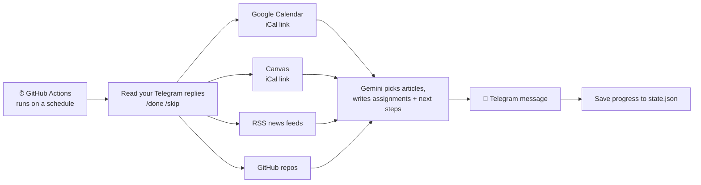

# ☀️ Daybreak

**Your whole morning in one message.** Daybreak reads your calendar, your Canvas
due dates, the news, your LeetCode progress, and your GitHub projects, then
sends you a single Telegram message each morning with everything you need for
the day, plus an evening check-in so nothing slips.

## The problem

Every morning I opened five or six apps just to figure out my day:

- **Google Calendar** to see my classes and meetings
- **Canvas** to see what's due (and usually discovered something due *tonight*)
- **News sites**, where I wanted to keep up with finance, data science, and medicine
  but never knew what was worth reading, so I usually read nothing
- **LeetCode**, where I spent more time choosing a problem than solving one
- **GitHub**, to remember where I'd left off on my projects

That's 10–15 minutes of tab-switching before doing anything useful, every single
day. And the stuff that wasn't urgent (learning, practice, side projects) was
always the first thing to get dropped.

## The solution

Daybreak does that whole routine for you and sends the result to your phone:

```
☀️ Good morning, Rayha!  Monday, October 12

📅 Today
• All day  Career Fair (Engineering)
• 9:10 AM–10:00 AM  CHEM 107 Lecture · Heldenfels Hall 100
• 3:30 PM–5:00 PM  ADSC project team meeting · Zoom

📚 Due in the next 3 days
• ⚠️ Today 11:59 PM — Quiz 4: Stoichiometry (CHEM-107-501)
• Wed Oct 14 — Lab Report 3 (ENGR-102-520)

📰 Morning reads
• [Finance] Fed signals pause as inflation cools — CNBC
   Explains why rate decisions move stock and bond prices.
• [Data Science] A gentle intro to gradient boosting — Towards Data Science
• [Medicine] How GLP-1 drugs work — STAT News

📝 Today's learning assignments
• Finance: Explain in 3 sentences how a rate pause affects bank stocks.
• Data Science: Fit a GradientBoostingClassifier on a toy dataset; compare to a single tree.
• Medicine: Look up what "Phase 3 trial" means and why most drugs fail there.

💻 LeetCode of the day
Two Sum (Easy · Arrays & Hashing)
Progress: 4/69 · 🔥 3-day streak
Reply /done when you solve it or /skip to move on.

🛠 Projects
• daybreak: Add the evening check-in (open issue #3)

💡 Busy morning: knock out the quiz before the career fair.
```

## The 3 big quality-of-life improvements

### 1. 📅 "What's my day?" answered in one place
Your calendar and Canvas are merged into one schedule, with **⚠️ warnings for
anything due today or tomorrow**. Canvas is optional: if you don't add a Canvas
link, that section just doesn't appear. Repeating classes, cancelled classes,
moved rooms, all-day events, and daylight saving time are all handled.

### 2. 📰 Learning on autopilot
You write your goals in plain English (e.g., *"understand markets and how
companies make money"*). Every morning Daybreak pulls fresh articles from news
feeds you choose, and an AI (Gemini) **picks the most worthwhile one per goal
and writes a 15–30 minute "assignment"** based on it. It sizes tasks to how busy
your day is and never repeats an article or assignment.

### 3. 💻 Momentum on practice and projects
- **LeetCode:** no more choosing. It walks through the Blind 75 in a sensible
  order. Reply **/done** or **/skip** in Telegram and it tracks your progress and
  🔥 streak.
- **Projects:** it reads your recent commits and open GitHub issues and suggests
  one concrete next step per project.
- **🌙 Evening check-in:** if you haven't done today's problem, or something is
  due before tomorrow night, you get a short nudge. If there's nothing to say, it
  stays quiet.

## How it works



| Piece | What I used | Why |
|---|---|---|
| Runs every day | **GitHub Actions** (scheduled workflow) | Free, no server to maintain, laptop can be off |
| Calendar + Canvas | **iCal feed links** | Both offer one. Read-only and no OAuth sign-in, so it's simpler and safer than full APIs |
| News | **RSS feeds** | Free and standard; works with almost any site, no API keys |
| Picking + writing | **Gemini API** (free tier) | One request per day; falls back to a non-AI brief if unavailable |
| Delivery | **Telegram bot** | Free, instant setup, supports links and formatting, and you can reply with commands |
| Memory between days | **state.json** committed back to the repo | No database needed |

Everything degrades gracefully: a broken feed, a missing calendar, or an AI
outage only removes that one piece; the rest of the brief still arrives.

---

## Setup (about 20 minutes)

### 1. Get the code onto GitHub
1. Go to [github.com/new](https://github.com/new), name the repo `daybreak`, and create it.
   *Public* is recommended (GitHub Actions minutes are unlimited for public repos).
   Your secrets stay private either way.
2. Upload all of these files (drag and drop works on the repo page, or use `git push`).
   Make sure the hidden `.github/workflows` folder is included. On a Mac, folders
   starting with a dot are hidden in Finder; press **Cmd + Shift + .** to show them.
   After uploading, you should see a `.github` folder on the repo page. Without it,
   nothing runs on a schedule.

### 2. Create your Telegram bot
1. Install Telegram on your phone and make an account.
2. Search for **@BotFather** (the official bot with a blue checkmark) and open it.
3. Send `/newbot`. Pick a display name (e.g. *Daybreak*) and a username that ends in `bot`
   (e.g. `rayha_daybreak_bot`).
4. BotFather replies with a **token** like `123456:ABC-xyz…`. Copy it; this is your
   `TELEGRAM_BOT_TOKEN`.

### 3. Find your chat ID
1. Tap the link BotFather gave you to open your new bot, press **Start**, and send it `hi`.
2. In a browser, open:
   `https://api.telegram.org/bot<YOUR_TOKEN>/getUpdates` (paste your token, no `<>`).
3. Find `"chat":{"id":` followed by a number. That number is your `TELEGRAM_CHAT_ID`.

   *(Or run `python main.py setup` on your laptop with the token in `.env`.)*

### 4. Get your private calendar links
**Google Calendar** (on a computer):
1. Open [calendar.google.com](https://calendar.google.com) → ⚙️ gear icon → **Settings**.
2. On the left under *Settings for my calendars*, click your calendar.
3. Scroll to **Integrate calendar** → copy **Secret address in iCal format**.

**Canvas** (optional):
1. Open Canvas → **Calendar** in the left menu.
2. At the bottom of the right sidebar, click **Calendar Feed** and copy the link.

> 🔒 These links let anyone who has them *read* your calendar, so they go in
> GitHub Secrets (next step), never in `config.yaml`. If one ever leaks, Google
> has a "Reset" button next to the secret address.

### 5. Get a Gemini API key (optional but recommended)
1. Go to [aistudio.google.com](https://aistudio.google.com) and sign in.
2. Click **Get API key** → **Create API key** → copy it.

Without a key, Daybreak still works; it just picks the newest article per goal
and uses simpler built-in assignments.

### 6. Add everything as GitHub Secrets
In your repo: **Settings → Secrets and variables → Actions → New repository secret**.
Add each of these (names must match exactly):

| Name | Value |
|---|---|
| `TELEGRAM_BOT_TOKEN` | from step 2 |
| `TELEGRAM_CHAT_ID` | from step 3 |
| `GOOGLE_CALENDAR_ICS` | from step 4 |
| `CANVAS_ICS` | from step 4 (optional) |
| `GEMINI_API_KEY` | from step 5 (optional) |
| `GH_PAT` | optional: a [fine-grained token](https://github.com/settings/tokens?type=beta) with read access, only if you want **private** repos in the Projects section |

### 7. Make it yours
Edit `config.yaml` (you can do this right on GitHub with the ✏️ pencil icon):
your name, send times, goals, news feeds, and projects. Comments in the file
explain each setting.

### 8. Test it
1. Go to the **Actions** tab. If GitHub asks, click to enable workflows.
2. Click **Daybreak** on the left → **Run workflow** → choose `morning` → **Run workflow**.
3. Within about a minute, your phone should buzz. 🎉

From now on it runs by itself every morning (and evening).

### Running on your laptop (optional)
```bash
pip install -r requirements.txt
cp .env.example .env        # then fill in your values
python main.py preview      # prints today's brief without sending
python main.py send morning # actually sends it
python -m unittest discover tests -v   # run the tests (no internet needed)
```

## Telegram commands
| Reply | What it does |
|---|---|
| `/done` | Marks today's LeetCode problem solved (+ streak) |
| `/skip` | Skips today's problem and moves on |
| `/help` | Lists commands |

Replies are processed at the next check-in (morning or evening), and the next
message confirms them.

## Notes and limits
- GitHub's scheduler can run a few minutes late; the brief usually arrives 7:00–7:20.
- GitHub pauses scheduled workflows in public repos with no activity for 60 days.
  Daybreak commits `state.json` daily, which should keep it active. If GitHub ever
  emails you that it disabled the workflow, re-enable it in the Actions tab.
- LeetCode has no official API, so progress is tracked from your `/done` replies
  rather than read from your LeetCode account.

## Roadmap
- [ ] Real SMS delivery (Twilio toll-free number) with a link to the full brief
- [ ] Google Calendar API so it can also *add* study blocks to free time
- [ ] Weekly summary: articles read, problems solved, streak history
- [ ] Web page to edit goals without touching YAML
